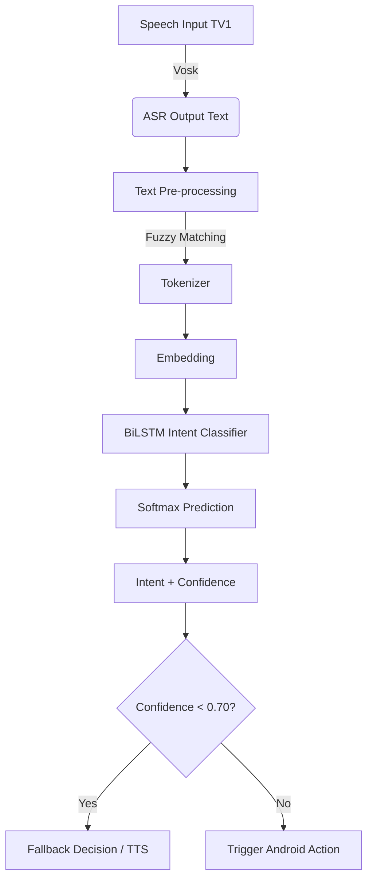
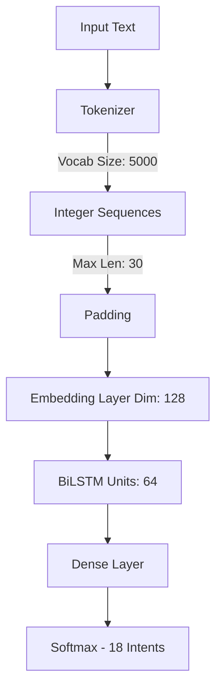

# 🏥 NLU Core Module - Mobile Edge AI Healthcare Assistant


**NLU Core (Natural Language Understanding)** là module xử lý ngôn ngữ tự nhiên cốt lõi của hệ thống trợ lý y tế offline dành cho người cao tuổi trên nền tảng Android.

---

## 📑 Mục lục
- [Giới thiệu](#-giới-thiệu)
- [Mục tiêu nghiên cứu](#-mục-tiêu-nghiên-cứu)
- [Kiến trúc hệ thống](#-kiến-trúc-hệ-thống)
- [18 Intent Cốt Lõi](#-18-intent-cốt-lõi)
- [Thực thể (Entity Baseline)](#-thực-thể-entity-baseline)
- [Cài đặt & Huấn luyện](#-cài-đặt--huấn-luyện)
- [Tích hợp Android](#-tích-hợp-android)
- [Nghiên cứu & Mở rộng](#-nghiên-cứu--mở-rộng)
- [Cấu trúc dự án](#-cấu-trúc-dự-án)

---

## 📖 Giới thiệu
Module này chịu trách nhiệm:
- **Phân loại ý định người dùng** (Intent Classification).
- **Trích xuất thực thể y tế cơ bản** (Entity Extraction Baseline).
- **Chạy suy luận AI hoàn toàn offline** trên thiết bị Android thông qua TensorFlow Lite.
- Hỗ trợ pipeline **Mobile Edge AI** chuyên biệt cho hệ thống y tế.

## 🎯 Mục tiêu nghiên cứu
Hệ thống hướng tới các tiêu chí khắt khe:
- 🚫 **Offline 100%**: Không phụ thuộc Internet.
- 🔒 **Bảo mật**: Đảm bảo riêng tư dữ liệu y tế người dùng tuyệt đối.
- ⚡ **Tối ưu hóa**: Hoạt động mượt mà trên thiết bị Android cấu hình thấp (Inference Time < 100ms).
- 🛡️ **Robustness**: Chống nhiễu ASR (Error Propagation) - tự động sửa lỗi nhận diện giọng nói bằng Fuzzy Matching.

## 🏗 Kiến trúc hệ thống

### 1. Luồng xử lý NLU (NLU Pipeline)



### 2. Kiến trúc Mô hình (Model Architecture)



### 3. Siêu tham số (Hyperparameters)
```python
VOCAB_SIZE = 5000
MAX_LEN = 30
EMBED_DIM = 128
LSTM_UNITS = 64
BATCH_SIZE = 16
EPOCHS = 30
```

## 🧠 18 Intent Cốt Lõi

Được chia thành 3 nhóm chính:

### 🏥 Core Intents (Y tế)
1. `request_emergency` - Yêu cầu cấp cứu.
2. `report_symptom` - Khai báo triệu chứng bệnh.
3. `inquire_medicine` - Hỏi thông tin thuốc.
4. `set_or_update_medication` - Đặt/cập nhật lịch uống thuốc.
5. `cancel_medication` - Hủy lịch uống thuốc.
6. `check_medication` - Kiểm tra lịch uống thuốc.
7. `set_or_update_appointment` - Đặt/cập nhật lịch khám.
8. `cancel_appointment` - Hủy lịch khám.
9. `check_appointment` - Kiểm tra lịch khám.

### 💬 Interaction Intents (Giao tiếp)
10. `small_talk` - Trò chuyện phím.
11. `ask_help` - Yêu cầu giúp đỡ.
12. `ask_date_time` - Hỏi ngày giờ.

### 🎛 Control Intents (Điều khiển hệ thống)
13. `affirm` - Đồng ý/Xác nhận.
14. `deny` - Từ chối.
15. `ask_repeat` - Yêu cầu nhắc lại.
16. `stop_action` - Dừng hành động.
17. `fallback` - Không hiểu/Dưới ngưỡng confidence.
18. `out_of_scope` - Nằm ngoài phạm vi hỗ trợ.

## 🏷 Thực thể (Entity Baseline)

Hệ thống trích xuất các nhóm thực thể cơ bản sau:
- **Y tế (Medical):** `@med_name`, `@symptom`, `@body_part`, `@severity`, `@specialty`
- **Thời gian (Time):** `@datetime`, `@duration`, `@frequency`
- **Hành động (Action):** `@dosage`

## ⚙️ Cài đặt & Huấn luyện

### 1. Yêu cầu dữ liệu (Dataset Requirements)
Tối thiểu: **50 samples / intent** (Tổng ~900 samples).
Mục tiêu: **150-300 samples / intent** (Tổng >3000 utterances).

Định dạng mẫu (`data/mock_data.xlsx`):

| text | intent |
|---|---|
| đau ngực khó thở | `request_emergency` |
| tôi đau đầu | `report_symptom` |
| thuốc panadol dùng sao | `inquire_medicine` |

### 2. Cài đặt môi trường

```bash
# Clone repository
git clone <your_repo_url>
cd NLU_Module

# Tạo virtual environment & kích hoạt
python -m venv venv
source venv/bin/activate  # Linux/Mac
# venv\Scripts\activate   # Windows

# Cài đặt thư viện
pip install -r requirements.txt
```

### 3. Quy trình huấn luyện (Training Pipeline)

```bash
# 1. Tiền xử lý dữ liệu
python src/preprocess.py

# 2. Huấn luyện mô hình TensorFlow/Keras
python src/train_nlu.py

# 3. Chuyển đổi sang TensorFlow Lite (Cho Edge AI)
python src/convert_to_tflite.py

# 4. Kiểm tra suy luận trên TFLite
python src/tflite_inference_test.py
```

## 📱 Tích hợp Android

Quá trình bàn giao cho đội ngũ Android App bao gồm **3 artifacts chính**:

1. **`nlu_model.tflite`**: Mô hình AI chạy offline trên Android bằng TensorFlow Lite. Yêu cầu inference latency thấp, tối ưu hóa cho mobile.
2. **`keras_tokenizer.json`**: Từ điển (dictionary) dùng để chuyển văn bản thành vector số (vd: `đau -> 14`, `ngực -> 62`).
3. **`label_encoder.json`**: Ánh xạ từ index output sang tên intent tương ứng (vd: `0 -> request_emergency`).

### Giao thức Data (Team Integration Contract)
**Input JSON:**
```json
{
  "text": "đau ngực khó thở"
}
```

**Output JSON:**
```json
{
  "intent": "request_emergency",
  "confidence": 0.96,
  "low_confidence": false
}
```
*Lưu ý:* Nếu `confidence < 0.70`, cờ `low_confidence` sẽ được bật để Android trigger kịch bản Fallback (Ví dụ: "Tôi chưa hiểu rõ, bác có thể nói lại không?").

### Cam kết KPI (KPI & Commitments)
- Clean Text Accuracy: **>= 90%**
- ASR Noisy Accuracy: **>= 80%**
- Inference Time: **< 100ms**
- Task Success Rate: **>= 85%**

## 🔬 Nghiên cứu & Mở rộng

### Error Propagation Study (Nghiên cứu lan truyền lỗi)
Đo lường sự sụt giảm độ chính xác khi đưa văn bản từ nhận diện giọng nói (ASR) vào NLU.
Ví dụ:
- Clean: *"đau tim dữ dội"*
- ASR: *"đau chim dữ dội"*

### Fuzzy Matching (Week 5)
Tích hợp thuật toán xử lý mờ (Levenshtein Distance / RapidFuzz) để sửa lỗi ASR trước khi phân loại ý định (vd: `chim mạch` -> `tim mạch`, `đỏ mép áo` -> `huyết áp`).

### Các mô hình thay thế (Ablation Studies)
- **Baseline Models:** TF-IDF + SVM, Logistic Regression.
- **Deep Learning:** BiLSTM, TextCNN, PhoBERT Embedding.
- Thử nghiệm với Clean Text vs ASR Text, có/không có VAD.

## 📂 Cấu trúc dự án

```text
NLU_Module/
├── data/                   # Dữ liệu huấn luyện
│   ├── mock_data.xlsx      
│   ├── raw_intents.csv     
│   └── medical_dict.json   
├── models/                 # Model đã huấn luyện và metadata
│   ├── nlu_model.h5
│   ├── nlu_model.tflite
│   ├── keras_tokenizer.json
│   └── label_encoder.json
├── reports/                # Báo cáo đánh giá (Evaluation)
│   ├── classification_report.txt
│   └── error_propagation_report.md
├── logs/                   # Log chạy hệ thống
├── src/                    # Mã nguồn chính
│   ├── config.py
│   ├── preprocess.py
│   ├── train_nlu.py
│   ├── convert_to_tflite.py
│   ├── tflite_inference_test.py
│   └── evaluate.py
├── java_reference/         # Code tham khảo tích hợp Android (Java)
│   ├── IntentPredictor.java
│   └── FuzzyMatcher.java
├── requirements.txt        # Các thư viện phụ thuộc
└── README.md               # Tài liệu dự án
```

---
**Author:** TV3 — NLU Core Lead  
**Project:** Mobile Edge AI Healthcare Assistant (Research Prototype)  
**Keywords:** `Mobile Edge AI`, `Offline Healthcare Assistant`, `TensorFlow Lite`, `Intent Classification`, `Vietnamese NLU`, `Error Propagation`, `Android AI Inference`